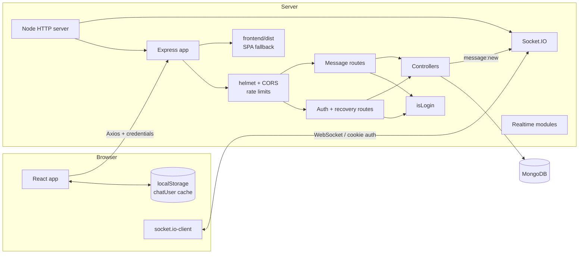
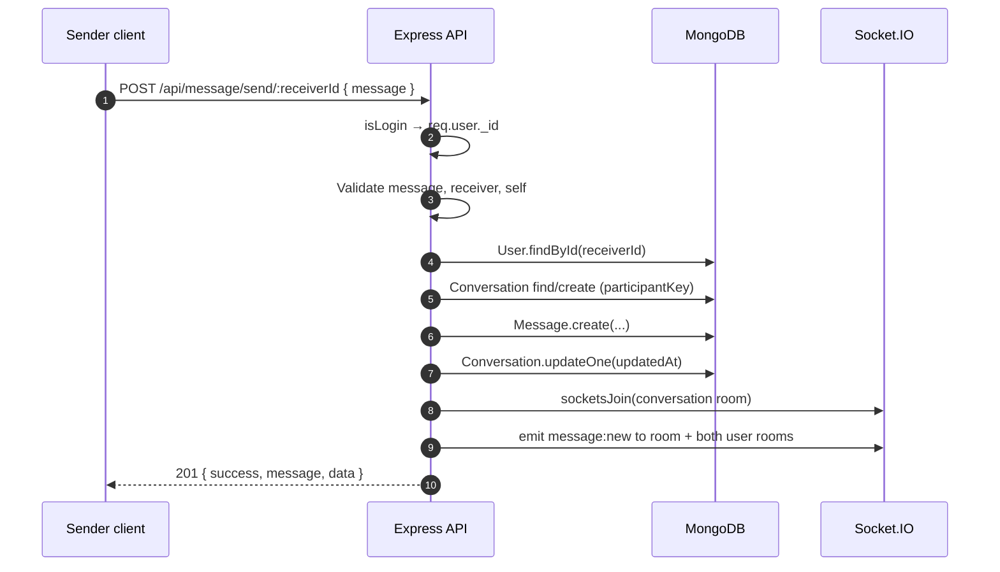

# Architecture

NexChat has a React single-page client and an Express API backed by MongoDB. Socket.IO shares the same HTTP server and auth cookie. In development Vite serves the client and proxies API/socket traffic to Express; in production Express serves the built client and keeps everything same-origin.

## System overview



The process validates environment variables, connects to MongoDB, then starts the HTTP server with Socket.IO attached.

## Folder structure

```
backend/
├── app.js                        # Express middleware, routes, static frontend, errors
├── index.js                      # HTTP server + Socket.IO, DB connect, graceful shutdown
├── config/env.js                 # dotenv, parsed env, required-env checks
├── DB/dbConnect.js               # mongoose.connect(env.mongoUri)
├── Modes/                        # Mongoose models ("Modes" is the existing spelling)
│   ├── useModels.js              # User + recovery fields + tokenVersion
│   ├── conversationModels.js     # Conversation
│   └── messageSchema.js          # Message
├── middleware/
│   ├── isLogin.js                # Cookie JWT verification + tokenVersion check
│   ├── rateLimit.js              # Auth, recovery, message-send limits
│   └── errorHandler.js           # 404 and centralized error mapping
├── realtime/
│   ├── io.js                     # Shared io instance and room helpers
│   └── socket.js                 # Socket auth, rooms, presence, typing
├── rout/
│   ├── authuser.js               # /api/auth routes, including recovery
│   └── messageRout.js            # /api/message routes
├── routControlers/
│   ├── userroutControler.js      # Register/login/recovery/users
│   └── messageroutControler.js   # Conversations, send, history, realtime emit
├── tests/
│   ├── api.test.js               # REST/auth/recovery integration tests
│   └── realtime.test.js          # Socket.IO integration tests
└── utils/
    ├── authCookie.js             # Shared cookie options
    ├── jwtwebToken.js            # JWT signing + cookie
    ├── securityQuestions.js      # Question catalog + answer normalization
    └── validation.js             # Input validation/pagination helpers

frontend/src/
├── api.js                        # Axios + API/Socket URLs
├── App.jsx                       # Routes + session loading gate
├── main.jsx                      # BrowserRouter, AuthProvider, ToastProvider
├── context/
│   ├── AuthContext.jsx           # Session/revalidation/login/reset/logout
│   ├── ChatContext.jsx           # Contacts, conversations, messages, sockets
│   └── ToastContext.jsx          # Notifications
├── pages/
│   ├── Auth.jsx / Auth.css       # Login/register/recovery UI
│   └── Chat.jsx                  # Chat layout
└── components/                   # Sidebar, ChatPanel, MessageBubble, etc.
```

The backend uses ES modules; relative imports include `.js`.

## Backend layers

1. **Entry point** — `backend/index.js` validates env, connects MongoDB, creates an `http.Server`, attaches Socket.IO, and handles `SIGINT`/`SIGTERM`. Socket.IO close also closes the HTTP server; a 10-second timer forces exit.
2. **App** — `backend/app.js` builds Express with Helmet/CSP, CORS, JSON parsers, cookies, routers, health, static frontend/SPA fallback, 404, and error handling.
3. **Configuration** — `backend/config/env.js` parses `PORT`, comma-separated `CLIENT_ORIGIN`, `MONGO_URI`, and `JWT_SECRET`. Production requires a 32+ character secret.
4. **Middleware** — `isLogin` verifies the cookie JWT, checks `tokenVersion`, and loads the user. Rate limiters protect auth, recovery, and sends. The error handler maps malformed JSON, validation/cast errors, duplicate keys, and unexpected failures.
5. **Routers** — map paths to controllers. Specific paths (`/conversations`, `/recovery/catalog`) precede parameterized paths.
6. **Controllers** — validate/normalize input, query MongoDB, emit realtime events, and return JSON.
7. **Models** — define validation, indexes, and collections.
8. **Realtime** — authenticates socket handshakes with the same cookie, joins per-user/per-conversation rooms, tracks presence, and broadcasts typing state.

## Route map

| Mount | Router | Routes |
| --- | --- | --- |
| `/api/auth` | `authuser.js` | `POST /register`, `POST /login`, `POST /logout`, `GET /me`, `GET /users`, `GET /recovery/catalog`, `POST /recovery/questions`, `POST /recovery/reset` |
| `/api/message` | `messageRout.js` | `GET /conversations`, `POST /send/:id`, `GET /:conversationId` |
| `/api/health` | `app.js` | `GET /api/health` |
| `/` | `app.js` | Built frontend `index.html`, or a plain-text liveness message when no build exists |
| `/socket.io` | Socket.IO | WebSocket/HTTP long-polling transport |

See the [API Reference](api-reference.md) for payloads and Socket.IO events.

## Authentication and recovery

### Registration

1. Validate and normalize profile fields plus 2–3 distinct security answers.
2. Reject duplicate usernames/emails with field-specific messages.
3. Hash the password and each normalized answer with bcrypt (cost 10).
4. Generate an avatar if absent.
5. Create the user, sign `{ userId, tokenVersion }`, and set the `jwt` cookie.

### Login

1. Normalize the email.
2. Select `+password +tokenVersion`.
3. Compare with bcrypt; return the same generic `Invalid email or password` for unknown email or wrong password.
4. Sign a JWT containing the current `tokenVersion` and set the cookie.

### Session validation

`isLogin` reads `req.cookies.jwt`, verifies the signature/expiry, loads the user with `+tokenVersion`, and rejects the token if its version differs. It sets `req.user` and calls `next()`. `GET /auth/me` returns an explicit public projection, not the raw Mongoose document.

### Password recovery

1. `GET /recovery/catalog` returns the fixed question list.
2. `POST /recovery/questions` accepts an email and returns that account's configured question IDs. Unknown accounts receive a decoy set; the response shape is identical.
3. `POST /recovery/reset` verifies all answers against bcrypt hashes in constant-set comparisons, hashes the new password, increments `tokenVersion`, saves, signs a fresh cookie, and disconnects the account's live sockets.
4. Wrong answers, unknown emails, and accounts without recovery data all return the same `401` message.
5. Incrementing `tokenVersion` invalidates every older session on the next protected request or socket handshake, while live sockets are closed immediately.

Recovery endpoints are rate limited to 12 requests per 15 minutes per IP. Answers are normalized (NFKC, trimmed, lowercased, whitespace collapsed) before hashing.

### Socket authentication

The handshake reads the same `jwt` cookie, verifies it, loads `+tokenVersion`, and rejects mismatches. Authenticated sockets join:

- `user:<userId>` — used for presence, new conversations, and messages from users not yet in the conversation room.
- `conversation:<conversationId>` for every conversation the user participates in at connect time.

When a conversation is created, the sender/receiver sockets are joined to its room immediately.

## Messaging flow

### Sending



`senderId`, `reciverId` (existing spelling), and `conversationId` are stored on every message. `participantKey` is the two user IDs sorted and joined with `:`, protected by a unique sparse index. If two first messages race, the loser re-reads the winner's conversation.

### Conversation discovery and history

- `GET /message/conversations` populates public participant summaries and aggregates the latest message per conversation, sorted by `updatedAt`.
- `GET /message/:conversationId` requires membership, fetches newest-first with an `_id` cursor (`limit + 1`), reverses the page for display, and enriches messages with sender/receiver summaries.
- `pagination.nextCursor` is the oldest message ID in the page and doubles as the next `before` value.

### Realtime delivery

- `message:new` payload: `{ conversationId, message }`, where `message` has the same fields as the REST send payload.
- The event is emitted to the conversation room plus both participants' user rooms. Socket.IO deduplicates sockets that belong to multiple target rooms.
- `typing:start` / `typing:stop` from a client are relayed as `typing:update` to the other members of that conversation room. The server verifies the socket has joined the room.
- Presence uses a per-user connection count, so multiple tabs do not produce false offline events. New sockets receive `presence:state`; all clients receive `presence:update` when a user's first socket connects or last socket disconnects.

The frontend deduplicates by message `_id` because the sender can receive both the REST response and the socket broadcast.

## Middleware and error handling

| Middleware | Applies to | Behavior |
| --- | --- | --- |
| `helmet` | All requests | Security headers and CSP; external HTTPS avatars and WebSocket connections allowed |
| `cors` | All requests | `CLIENT_ORIGIN` allowlist with credentials |
| `express.json({ limit: "100kb" })` | All requests | Malformed JSON → `400`; oversized → `413` |
| `cookie-parser` | All requests | Populates `req.cookies` |
| `authLimiter` | Register/login | 30 requests / 15 min / IP |
| `recoveryLimiter` | Recovery questions/reset | 12 requests / 15 min / IP |
| `messageSendLimiter` | Send message | 120 requests / min / IP |
| `isLogin` | Protected routes | JWT + tokenVersion verification, user loading |
| Socket auth middleware | Socket handshake | Same JWT + tokenVersion checks, then room joins |
| `notFoundHandler` | Unmatched routes | `404 { success: false, message: "Route not found" }` |
| `errorHandler` | All errors | Maps known errors; production hides unexpected details |

Tests set `NODE_ENV=test`, which disables rate limits and avoids `Secure` cookies.

## Design decisions and trade-offs

| Decision | Effect |
| --- | --- |
| JWT in an `HttpOnly` cookie | Protects the token from JavaScript/XSS reads; requires credentials and same-site deployment. |
| `SameSite=Strict` | Strong CSRF resistance; cross-site frontend hosting will not receive the cookie. |
| `tokenVersion` | Invalidates old cookies after a password reset and, combined with socket disconnection, ends live sessions. |
| Security questions instead of email | No SMTP dependency; recovery is weaker than email/MFA, so answers are hashed, normalized, rate-limited, and never returned. |
| Decoy recovery questions | Prevent account enumeration from the questions endpoint. |
| REST writes + Socket.IO broadcasts | REST remains the source of truth; sockets make delivery live without changing the API contract. |
| Conversation and user rooms | Message delivery works for open conversations and first messages. |
| Canonical `participantKey` | One conversation per pair, including concurrent first sends. |
| Cursor pagination | Stable paging while new messages arrive. |
| Static frontend from Express | Simple single-service demo with same-origin cookies, sockets, and no CORS. |

## Known architectural gaps

- No read receipts, unread counts, message editing/deletion, or group conversations.
- Presence is in-memory; multiple Socket.IO instances would need the Redis adapter and a shared presence store.
- Rate limiting uses an in-memory store; multi-instance deployments need Redis or another shared backend.
- No refresh-token rotation or per-device session management; logout clears the current cookie only.
- No structured logging, request IDs, metrics, or CI pipeline.
- No frontend automated tests.
- Security-question recovery is intentionally minimal; it is not a substitute for email verification or MFA.
