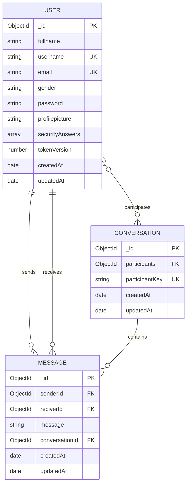

# Database

NexChat uses a single MongoDB database through Mongoose. The connection string comes from `MONGO_URI`. The API validates required environment variables, connects once at startup, and refuses to listen if the connection fails.

```js
// backend/DB/dbConnect.js
await mongoose.connect(env.mongoUri);
```

There is no migration system or seed script. Mongoose creates collections and indexes when models are first used (`autoIndex` is left at its default). For production, treat index creation as an explicit deployment step and plan data migrations separately.

## Entity relationships



- A **conversation** has exactly two participants. A schema validator enforces the length, and a unique `participantKey` enforces one conversation per pair.
- A **message** belongs to one conversation and references both the sender and receiver.
- `securityAnswers` is embedded in the user document. Only the question ID and a bcrypt hash of the normalized answer are stored.
- There are no deletion endpoints, so no cascade behavior is implemented.
- Users are referenced by conversations and messages but never embedded.

## Collections

| Model file | Model name | MongoDB collection |
| --- | --- | --- |
| `backend/Modes/useModels.js` | `User` | `users` |
| `backend/Modes/conversationModels.js` | `convesation` | `convesations` |
| `backend/Modes/messageSchema.js` | `Message` | `messages` |

> The conversation model is named `convesation` (misspelled) and exports as `Conversation`. Mongoose pluralizes the model name to `convesations`. Renaming it would affect existing data and imports, so the code keeps the existing name.

## User schema

Defined in `backend/Modes/useModels.js`.

| Field | Type | Constraints | Notes |
| --- | --- | --- | --- |
| `_id` | ObjectId | Auto | Primary key |
| `fullname` | String | Required, trimmed, max 80 | Validated again in the controller |
| `username` | String | Required, unique, trimmed, 3–30 chars, regex `^[a-zA-Z0-9._-]+$` | Used in the generated avatar URL |
| `email` | String | Required, unique, trimmed, lowercased, max 254, email regex | Login identifier |
| `gender` | String | Required, enum `male` / `female` | Normalized to lowercase by the controller |
| `password` | String | Required, **`select: false`** | Stores a bcrypt hash; excluded from queries by default |
| `profilepicture` | String | Trimmed, max 500, default `""` | Register fills in an avatar URL if omitted |
| `securityAnswers` | Array | **`select: false`**, `default: undefined`, 2–3 entries when present | Recovery questions. Each entry is `{ questionId, answerHash }` |
| `tokenVersion` | Number | **`select: false`**, default `0` | Embedded in new JWTs; incremented on password reset |
| `createdAt` | Date | Auto | Mongoose timestamps |
| `updatedAt` | Date | Auto | Mongoose timestamps |

### Security answers

The field is defined as:

```js
securityAnswers: {
    type: [{
        _id: false,
        questionId: {
            type: String,
            required: true,
            enum: SECURITY_QUESTION_IDS
        },
        answerHash: {
            type: String,
            required: true
        }
    }],
    select: false,
    default: undefined,
    validate: {
        validator: (answers) => !answers || (
            answers.length >= MIN_SECURITY_ANSWERS &&
            answers.length <= MAX_SECURITY_ANSWERS
        ),
        message: "Choose between 2 and 3 security questions"
    }
}
```

Registration requires 2–3 distinct questions at the controller level. The schema validator permits an absent value so legacy user documents remain valid; the controller does not.

Answers are processed before hashing:

1. Require a non-empty string.
2. Apply Unicode NFKC normalization.
3. Trim, lowercase, and collapse internal whitespace.
4. Reject answers longer than 120 characters.
5. Hash with bcrypt (cost 10).

Normalization makes `" New   Delhi "`, `"new delhi"`, and compatibility-equivalent Unicode forms match later. Answers are stored only as salted bcrypt hashes and are never returned by any endpoint.

The fixed question catalog lives in `backend/utils/securityQuestions.js`. Stored `questionId` values are part of the data model. Do not remove an ID from the catalog while stored answers still reference it: the recovery question lookup filters unknown IDs, and the schema enum would reject resaving those documents.

### Passwords and sessions

- Password hashing happens in the controller, not in a Mongoose `pre("save")` hook: `await bcryptjs.hash(password, 10)`.
- Login and password reset opt into hidden fields with `.select("+password +tokenVersion")`.
- `password` is `select: false`, so normal queries exclude it.
- Register, login, and reset build explicit response objects; `/api/auth/me` returns an explicit public projection.
- `tokenVersion` is included in the JWT payload. `isLogin` and the Socket.IO handshake load `+tokenVersion` and reject a token whose version does not match.
- Password reset increments `tokenVersion` with `$inc`, rejects older cookies on their next request/handshake, and disconnects the account's live sockets immediately.

Because hashing is not a model hook, creating a user directly with `User.create()` would store a plain-text password. Only the register controller hashes input.

### Unique indexes

`username` and `email` are declared `unique: true`.

- Emails are lowercased before lookup and storage, so new accounts are effectively case-insensitive by email.
- Usernames are trimmed but not lowercased; uniqueness remains case-sensitive.
- Duplicate-key errors (`code 11000`) are handled in the register controller with field-specific `400` messages.
- A duplicate race that reaches the global handler is mapped to `409` with a safe message.

## Conversation schema

Defined in `backend/Modes/conversationModels.js`.

| Field | Type | Constraints | Notes |
| --- | --- | --- | --- |
| `_id` | ObjectId | Auto | Primary key |
| `participants` | ObjectId[] | Default `[]`; each refs `User`; validator requires exactly 2 | Sender and receiver |
| `participantKey` | String | Unique, sparse | Canonical sorted participant IDs joined with `:` |
| `createdAt` | Date | Auto | Mongoose timestamps |
| `updatedAt` | Date | Auto | Bumped on every new message |

Conversations are created lazily by `POST /api/message/send/:id`:

```js
const participantKey = [senderId, receiverId]
  .map(String)
  .sort()
  .join(":");

let conversation = await Conversation.findOne({ participantKey });

if (!conversation) {
  conversation = await Conversation.create({
    participants: [senderId, receiverId],
    participantKey,
  });
}
```

The controller also:

1. Falls back to a `participants: { $all: [senderId, receiverId], $size: 2 }` lookup for conversations created before `participantKey` existed.
2. Backfills `participantKey` on a legacy conversation and ignores a duplicate-key race during backfill.
3. Catches a unique-index conflict on create and re-reads the winning conversation.

The `sparse` option keeps legacy conversations without a key valid. Legacy data may still contain duplicate conversations created before this constraint; new sends reuse the keyed conversation.

## Message schema

Defined in `backend/Modes/messageSchema.js`.

| Field | Type | Constraints | Notes |
| --- | --- | --- | --- |
| `_id` | ObjectId | Auto | Primary key |
| `senderId` | ObjectId | Required, refs `User` | Taken from `req.user._id` |
| `reciverId` | ObjectId | Required, refs `User` | Receiver's ID. **The field name is misspelled** and is part of the API contract |
| `message` | String | Required, trimmed, max 2000 | Controller validates length before insert |
| `conversationId` | ObjectId | Required, refs `Conversation` | Parent conversation |
| `createdAt` | Date | Auto | Mongoose timestamps |
| `updatedAt` | Date | Auto | Mongoose timestamps |

Message history uses a cursor query:

```js
Message.find({ conversationId, _id: { $lt: before } })
  .sort({ _id: -1 })
  .limit(limit + 1)
  .lean();
```

The controller reverses the fetched page for display and enriches each message with `sender` and `receiver` summaries.

## Sample documents

### User

```json
{
  "_id": "6650f1c2a4b8d9e1f2a3b4c5",
  "fullname": "Ada Lovelace",
  "username": "ada",
  "email": "ada@example.com",
  "gender": "female",
  "password": "$2b$10$examplehashreplacedinrealdata",
  "profilepicture": "https://avatar.iran.liara.run/public/girl?username=ada",
  "securityAnswers": [
    {
      "questionId": "first_pet",
      "answerHash": "$2b$10$examplehashforMilo"
    },
    {
      "questionId": "birth_city",
      "answerHash": "$2b$10$examplehashforLondon"
    },
    {
      "questionId": "first_school",
      "answerHash": "$2b$10$examplehashforHome"
    }
  ],
  "tokenVersion": 0,
  "createdAt": "2026-10-24T10:00:00.000Z",
  "updatedAt": "2026-10-24T10:00:00.000Z",
  "__v": 0
}
```

`password`, `securityAnswers`, and `tokenVersion` are present in stored documents but excluded from normal queries because they use `select: false`. Each answer hash is unique even when two users give the same answer, because bcrypt salts every hash.

### Conversation

```json
{
  "_id": "6650f3e4c6d0f1a2b3c4d6e7",
  "participants": [
    "6650f1c2a4b8d9e1f2a3b4c5",
    "6650f2d3b5c9e0f1a2b3c4d6"
  ],
  "participantKey": "6650f1c2a4b8d9e1f2a3b4c5:6650f2d3b5c9e0f1a2b3c4d6",
  "createdAt": "2026-10-24T10:05:00.000Z",
  "updatedAt": "2026-10-24T10:07:00.000Z",
  "__v": 0
}
```

### Message

```json
{
  "_id": "6650f4f5d7e1a2b3c4d6e7f8",
  "senderId": "6650f1c2a4b8d9e1f2a3b4c5",
  "reciverId": "6650f2d3b5c9e0f1a2b3c4d6",
  "message": "Hello Grace!",
  "conversationId": "6650f3e4c6d0f1a2b3c4d6e7",
  "createdAt": "2026-10-24T10:05:00.000Z",
  "updatedAt": "2026-10-24T10:05:00.000Z",
  "__v": 0
}
```

## Indexes

Declared in the model files:

| Collection | Index | Purpose |
| --- | --- | --- |
| `users` | `{ username: 1 }` unique | Prevent duplicate usernames and speed login/register lookups |
| `users` | `{ email: 1 }` unique | Prevent duplicate emails and speed login |
| `convesations` | `{ participantKey: 1 }` unique, sparse | One conversation per participant pair; legacy docs without a key allowed |
| `convesations` | `{ participants: 1, updatedAt: -1 }` | Conversation discovery filtered by participant and sorted by activity |
| `messages` | `{ conversationId: 1, _id: 1 }` | Conversation history filtering and `_id` cursor ordering |
| `messages` | `{ senderId: 1 }` | Messages sent by a user |
| `messages` | `{ reciverId: 1 }` | Messages received by a user |

Every collection also has MongoDB's built-in `_id` index. `securityAnswers` is not indexed because it is only read after an email lookup.

## Data integrity considerations

| Concern | Current behavior |
| --- | --- |
| Duplicate conversation for a pair | Prevented for new pairs by the unique `participantKey`; a race is retried by re-reading the winning conversation |
| Legacy duplicate conversations | Possible in data created before `participantKey`; new messages use the keyed conversation |
| Reading someone else's conversation | `403` unless the caller is in `participants` |
| Receiver existence | Verified before creating a conversation/message; unknown receiver returns `404` |
| Self-messaging | Rejected with `400` |
| Participant count | Schema validator requires exactly 2 |
| Message length | Controller and schema cap it at 2000 characters; JSON body limit is 100 KB |
| Password exposure | `select: false` plus explicit response fields |
| Security-answer exposure | `select: false`; only question IDs are returned to the account owner during recovery |
| Account enumeration | Unknown emails receive decoy questions, and reset failures share one generic message and similar bcrypt work |
| Session invalidation | Password reset increments `tokenVersion`, disconnects live sockets, and makes HTTP middleware/socket handshakes reject older versions |
| User privacy | Public user listing omits email and gender |
| Deleting users/messages | No endpoints; orphaned references are never cleaned up |
| Pagination | Users/conversations use `page` + `limit`; messages use a cursor |
| Search | Case-insensitive, regex-escaped search on `fullname`/`username` |
| Soft delete / audit trail | None |

## Operational notes

- Unique indexes are required for duplicate protection. If an existing database contains duplicate usernames, emails, or `participantKey` values, index creation will fail; clean the data before deploying.
- `participantKey` is derived data. If participants are ever edited, the key must be recomputed in the same operation.
- The `reciverId` spelling is part of stored data and the public API. A rename requires a coordinated migration and client update.
- The conversation model name `convesation` fixes the collection name. Renaming it would require migrating data and updating imports.
- Users created before security-question recovery was added have no `securityAnswers`. Their lookup returns decoy questions and reset attempts fail with the generic message. Backfilling requires collecting answers from those users; do not invent them.
- Treat the question catalog as append-only. Removing a question ID can strand accounts that selected it.
- Password reset changes `tokenVersion` but does not revoke the new cookie. Every other session is invalidated and live sockets are disconnected; the resetting session is signed in with the new version.
- Security answers are low-entropy secrets. Rate limiting and bcrypt slow guessing, but a database leak still exposes salted hashes that can be attacked offline. Use unique, non-public answers and treat backups as sensitive.
- There is no TTL or retention policy. Messages, conversations, and users grow indefinitely.
- Back up the database before applying index changes or data migrations.

## Connecting to the database

For a local MongoDB instance:

```dotenv
MONGO_URI=mongodb://127.0.0.1:27017/nexchat
```

For Atlas:

```dotenv
MONGO_URI=mongodb+srv://<user>:<password>@<cluster>/nexchat?retryWrites=true&w=majority
```

Startup logs:

```
DB connected successfully
Working at 3000
```

If the connection fails, `dbConnect` logs `DB connection failed: ...`, throws, and `startServer` logs `Server start nahi hua: ...`; the process exits without listening. `GET /api/health` reports `503` when a running server loses its database connection.
